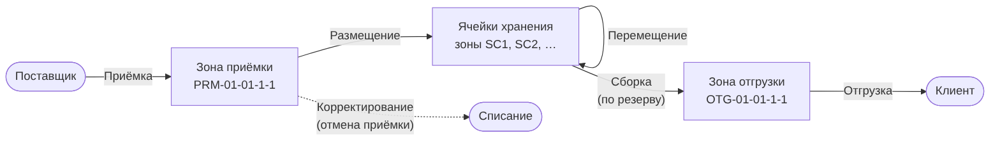
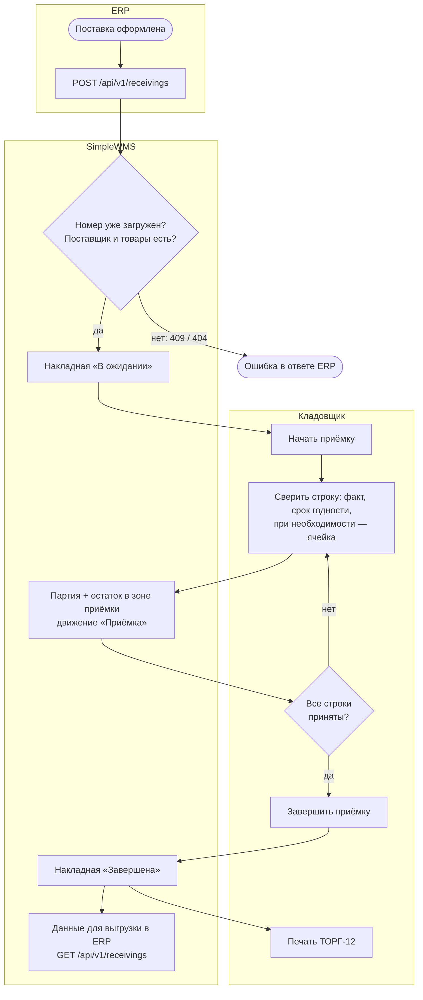
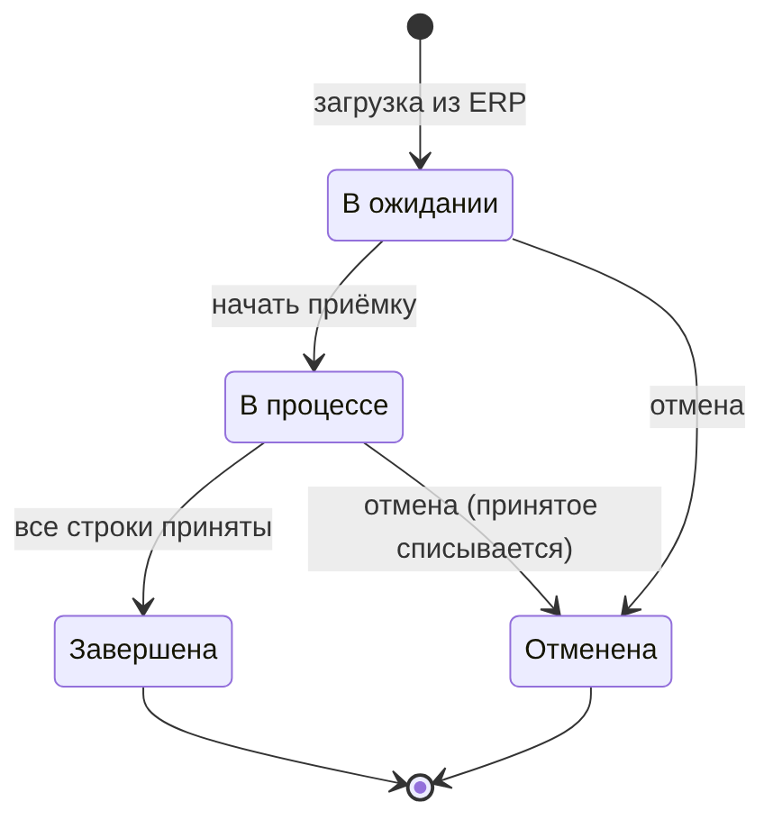
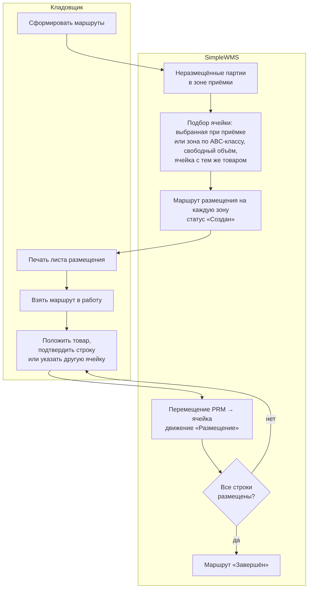
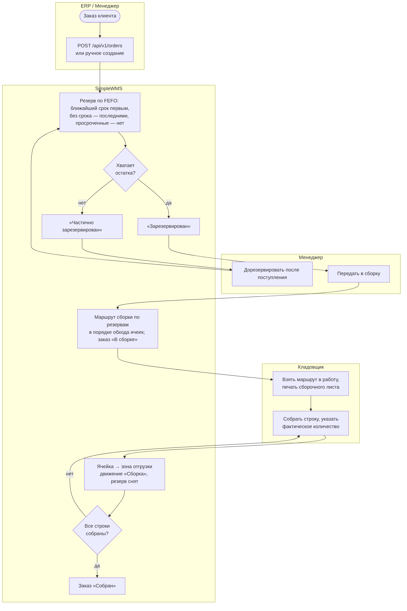
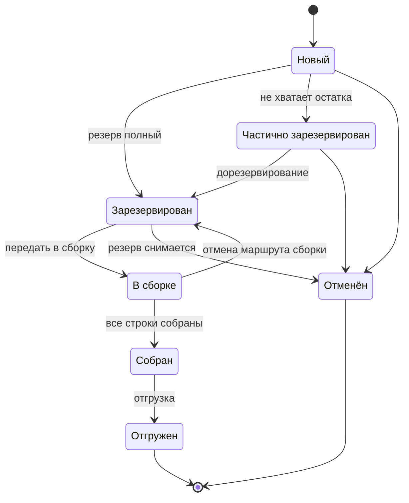
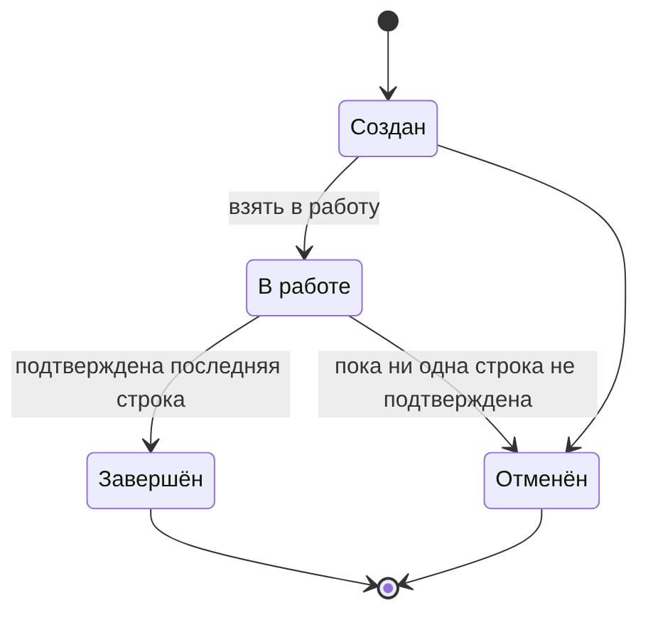
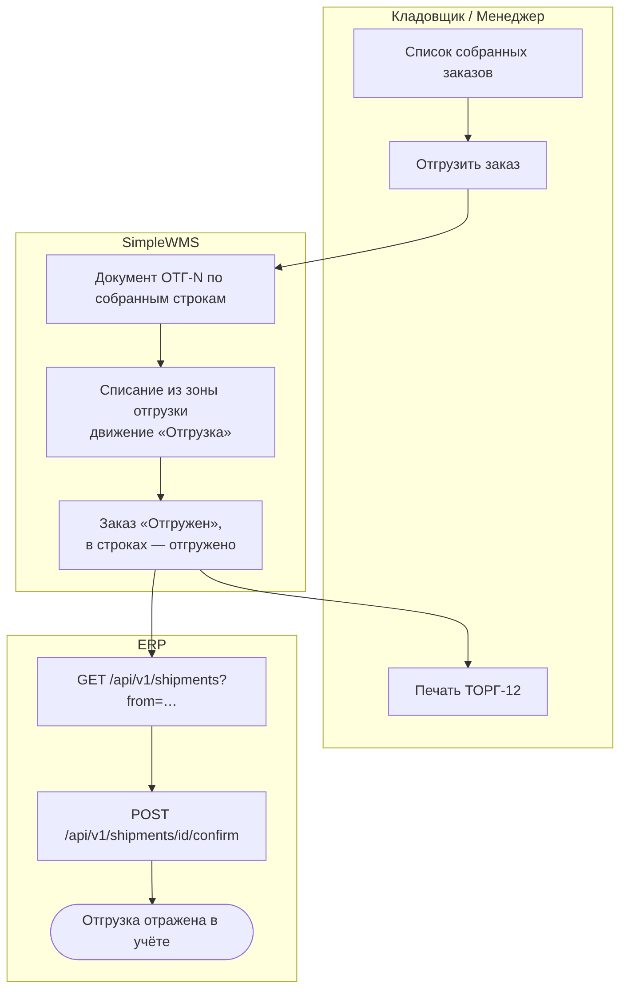
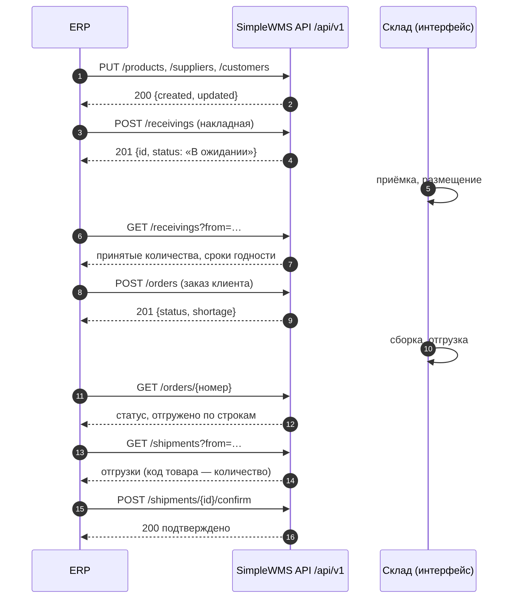

# Бизнес-процессы склада

Схемы выполнены в нотации блок-схем с дорожками участников (упрощённая BPMN), исходники — `diagrams/*.mmd`
(Mermaid). Подробности реализации — `Архитектура.md`.

## Движение товара по зонам склада

*Рисунок 2 — Движение товара по зонам и типы движений*

Любое изменение остатка выполняет `InventoryService`: остаток в таблице `stocks` и запись в журнале
`stock_movements` меняются в одной транзакции.

| Тип движения | Код | Откуда → куда | Процесс |
|---|---|---|---|
| Приёмка | 1 | — → зона приёмки | приёмка строки накладной |
| Размещение | 2 | приёмка → ячейка | маршрут размещения |
| Сборка | 3 | ячейка → зона отгрузки | маршрут комплектации |
| Отгрузка | 4 | зона отгрузки → — | отгрузка заказа |
| Корректирование | 5 | ячейка → — | возврат строки, отмена накладной |
| Перемещение | 7 | ячейка → ячейка | перемещение товара |

## 1. Приёмка

*Рисунок 3 — Процесс приёмки товара*

*Рисунок 4 — Статусы приходной накладной*

## 2. Размещение

*Рисунок 5 — Процесс размещения*

Правила подбора ячейки (`PlacementCellPicker`):
1. Ячейка, выбранная кладовщиком при приёмке, если в ней хватает места.
2. Иначе — ячейки предпочтительной зоны для ABC-класса товара (`wms.placement.abc-zones`), затем остальные зоны.
3. Среди подходящих — сначала ячейка, где уже лежит этот товар, затем ближайшая по адресу.
4. Учитывается занятый объём: остатки и строки ещё не завершённых маршрутов.

## 3. Резервирование и комплектация

*Рисунок 6 — Резервирование и комплектация заказа*

*Рисунок 7 — Статусы заказа клиента*

*Рисунок 8 — Статусы маршрутов размещения и комплектации*

## 4. Отгрузка и обмен с ERP

*Рисунок 9 — Отгрузка и передача результатов в ERP*

*Рисунок 10 — Последовательность обмена с ERP*
