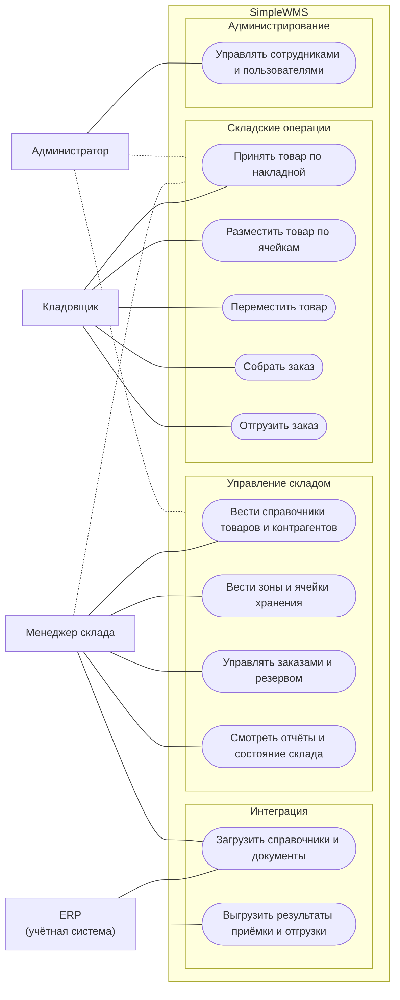

# Варианты использования

Роли и права — `Требования.md`, раздел 2.

*Рисунок 1 — Варианты использования SimpleWMS* (исходник: `diagrams/01_use_cases.mmd`)

## Описание основных вариантов использования

### ВИ-1. Загрузить приходную накладную (ERP)

| | |
|---|---|
| Участник | ERP |
| Предусловие | Поставщик и товары есть в справочниках (загружены ранее через API) |
| Основной сценарий | 1. ERP отправляет `POST /api/v1/receivings` с номером, кодом поставщика, датой и строками. 2. Система проверяет данные и уникальность номера. 3. Создаётся накладная «В ожидании», ERP получает id и статус |
| Альтернативы | Неверные данные — 400 с перечнем полей; поставщик не найден — 404; номер уже загружен — 409; товаров нет в справочнике — строки пропускаются и перечисляются в ответе |
| Результат | Накладная видна в «Приход товара» |

### ВИ-2. Принять товар по накладной (Кладовщик)

| | |
|---|---|
| Участник | Кладовщик |
| Предусловие | Накладная «В ожидании» |
| Основной сценарий | 1. Кладовщик открывает накладную и начинает приёмку. 2. По каждой строке вводит фактическое количество, срок годности (если требуется) и при желании ячейку. 3. Система создаёт партию и остаток в зоне приёмки. 4. После обработки всех строк кладовщик завершает приёмку. 5. Печатает ТОРГ-12 |
| Альтернативы | Не указан обязательный срок годности — ошибка; ошибочно принятая строка — «Вернуть строку» (остаток списывается, строку можно принять заново); накладную можно отменить |
| Результат | Накладная «Завершена», товар ожидает размещения |

### ВИ-3. Разместить товар (Кладовщик)

| | |
|---|---|
| Участник | Кладовщик |
| Предусловие | В зоне приёмки есть неразмещённые партии |
| Основной сценарий | 1. «Сформировать маршруты» — система подбирает ячейки и создаёт маршрут на каждую зону. 2. Кладовщик печатает лист размещения и берёт маршрут в работу. 3. Раскладывает товар и подтверждает строки. 4. Последняя строка завершает маршрут |
| Альтернативы | Товар положен в другую ячейку — выбирается в строке; не нашлось места — партия остаётся в приёмке, сообщение о количестве пропущенных строк; маршрут можно отменить до первой подтверждённой строки |
| Результат | Товар в ячейках хранения, доступен для резерва |

### ВИ-4. Зарезервировать заказ (ERP / Менеджер)

| | |
|---|---|
| Участники | ERP, Менеджер |
| Основной сценарий | 1. Заказ приходит через `POST /api/v1/orders` или создаётся менеджером. 2. Система резервирует остаток по FEFO. 3. Заказ получает статус «Зарезервирован» |
| Альтернативы | Остатка не хватает — «Частично зарезервирован», недостача в ответе и в карточке; после поступления — «Дорезервировать»; отмена заказа снимает резерв |
| Результат | Резерв закреплён за строками заказа по партиям и ячейкам |

### ВИ-5. Собрать заказ (Менеджер → Кладовщик)

| | |
|---|---|
| Участники | Менеджер, Кладовщик |
| Предусловие | Заказ «Зарезервирован» |
| Основной сценарий | 1. Менеджер передаёт заказ в сборку. 2. Кладовщик берёт маршрут в работу, печатает сборочный лист. 3. По каждой строке вводит собранное количество. 4. Последняя строка завершает маршрут, заказ «Собран» |
| Альтернативы | Собрано меньше плана — недостача фиксируется, резерв на разницу снимается; маршрут можно отменить до первой подтверждённой строки, заказ вернётся в «Зарезервирован» |
| Результат | Товар в зоне отгрузки |

### ВИ-6. Отгрузить заказ и передать в ERP

| | |
|---|---|
| Участники | Кладовщик / Менеджер, ERP |
| Предусловие | Заказ «Собран» |
| Основной сценарий | 1. На странице «Отгрузка заказа» нажать «Отгрузить». 2. Система создаёт документ ОТГ-N, списывает товар из зоны отгрузки, заказ «Отгружен». 3. Печать ТОРГ-12. 4. ERP забирает отгрузки `GET /api/v1/shipments` и подтверждает получение |
| Результат | Отгрузка в журнале с отметкой «передано в ERP» |
