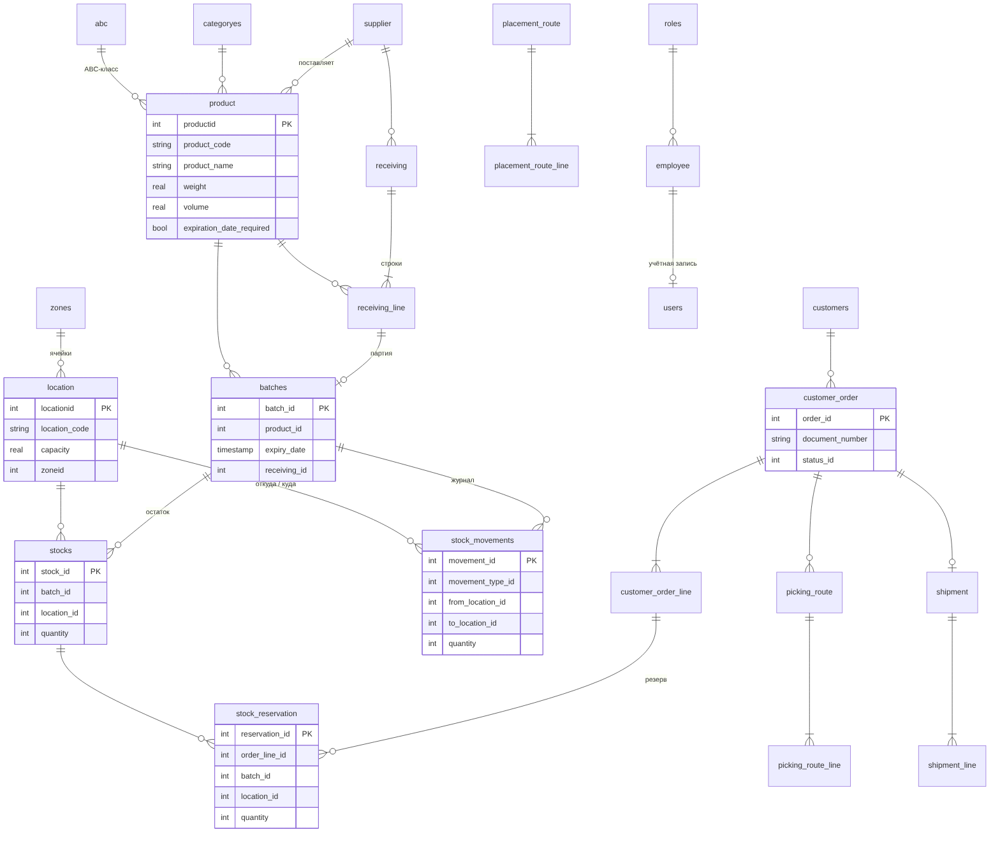

# Модель данных

База данных PostgreSQL 16. Схема создаётся и обновляется Hibernate по JPA-сущностям (`ddl-auto=update`),
начальные данные — скрипты `SQL/migrations/V00x` (выполняются при запуске приложения, повторный запуск безопасен).
Внешние ключи на уровне БД не объявлены: связи логические, целостность обеспечивают сервисы в транзакциях.

*Рисунок 11 — ER-диаграмма (основные таблицы и связи)*

Всего таблиц: 24. Признак `del` — логическое удаление записи (запись скрыта, но сохраняется для истории).

## Справочники

### `product` — Товары

| Поле | Тип | Обяз. |
|---|---|:---:|
| `productid` | integer | ✔ |
| `abcid` | integer | ✔ |
| `categoryid` | integer | ✔ |
| `del` | boolean |  |
| `description` | varchar |  |
| `expiration_date_required` | boolean |  |
| `ext_bar_code` | varchar |  |
| `int_bar_code` | varchar |  |
| `product_code` | varchar |  |
| `product_name` | varchar |  |
| `supplierid` | integer | ✔ |
| `volume` | real |  |
| `weight` | real |  |

### `categoryes` — Категории товаров

| Поле | Тип | Обяз. |
|---|---|:---:|
| `categoryid` | integer | ✔ |
| `category_name` | varchar |  |
| `del` | boolean |  |
| `description` | varchar |  |

### `abc` — ABC-классы товаров (A–D)

| Поле | Тип | Обяз. |
|---|---|:---:|
| `abcid` | integer | ✔ |
| `code` | varchar |  |
| `del` | boolean |  |
| `description` | varchar |  |

### `supplier` — Поставщики

| Поле | Тип | Обяз. |
|---|---|:---:|
| `supplierid` | integer | ✔ |
| `contact_person` | varchar |  |
| `del` | boolean |  |
| `email` | varchar |  |
| `phone_number` | varchar |  |
| `supplier_code` | varchar |  |
| `supplier_name` | varchar |  |

### `customers` — Клиенты

| Поле | Тип | Обяз. |
|---|---|:---:|
| `customer_id` | integer | ✔ |
| `address` | varchar |  |
| `customer_code` | varchar |  |
| `customer_name` | varchar |  |
| `del` | boolean |  |
| `email` | varchar |  |
| `phone` | varchar |  |
| `working_time_end` | varchar |  |
| `working_time_str` | varchar |  |

### `zones` — Зоны склада (PRM — приёмка, OTG — отгрузка, остальные — хранение)

| Поле | Тип | Обяз. |
|---|---|:---:|
| `zone_id` | integer | ✔ |
| `code` | varchar |  |
| `del` | boolean |  |
| `description` | varchar |  |
| `zone_name` | varchar |  |

### `location` — Ячейки (места хранения), вместимость в литрах

| Поле | Тип | Обяз. |
|---|---|:---:|
| `locationid` | integer | ✔ |
| `available` | integer | ✔ |
| `capacity` | real | ✔ |
| `del` | integer | ✔ |
| `location_code` | varchar |  |
| `row` | varchar |  |
| `x` | integer | ✔ |
| `y` | integer | ✔ |
| `z` | integer | ✔ |
| `zoneid` | integer | ✔ |

### `employee` — Сотрудники склада

| Поле | Тип | Обяз. |
|---|---|:---:|
| `employeeid` | integer | ✔ |
| `del` | integer | ✔ |
| `employee_name` | varchar |  |
| `roleid` | integer | ✔ |
| `tab_num` | varchar |  |

### `roles` — Роли (1 — Администратор, 2 — Менеджер склада, 3 — Кладовщик)

| Поле | Тип | Обяз. |
|---|---|:---:|
| `roleid` | integer | ✔ |
| `note` | varchar |  |
| `role_name` | varchar |  |

### `users` — Учётные записи пользователей (пароль — BCrypt)

| Поле | Тип | Обяз. |
|---|---|:---:|
| `userid` | integer | ✔ |
| `del` | boolean |  |
| `employeeid` | integer | ✔ |
| `login` | varchar |  |
| `pass` | varchar |  |

## Приёмка и размещение

### `receiving` — Приходные накладные

| Поле | Тип | Обяз. |
|---|---|:---:|
| `receivingid` | integer | ✔ |
| `del` | boolean |  |
| `document_number` | varchar |  |
| `employeeid` | integer | ✔ |
| `get_receiving_date` | timestamp |  |
| `receiving_date` | timestamp |  |
| `statusid` | integer | ✔ |
| `supplierid` | integer | ✔ |

### `receiving_line` — Строки приходных накладных: по документу и принято

| Поле | Тип | Обяз. |
|---|---|:---:|
| `receiving_lineid` | integer | ✔ |
| `complete` | boolean |  |
| `del` | boolean |  |
| `expiration_date` | timestamp |  |
| `locationid` | integer | ✔ |
| `note` | varchar |  |
| `placement_route` | boolean |  |
| `productid` | integer | ✔ |
| `quantity_product` | integer | ✔ |
| `quantity_received` | integer | ✔ |
| `receivingid` | integer | ✔ |

### `batches` — Партии товара: одна принятая строка накладной = одна партия, срок годности

| Поле | Тип | Обяз. |
|---|---|:---:|
| `batch_id` | integer | ✔ |
| `date_received` | timestamp |  |
| `del` | boolean |  |
| `expiry_date` | timestamp |  |
| `product_id` | integer | ✔ |
| `quantity_received` | integer | ✔ |
| `receiving_id` | integer | ✔ |
| `supplier_id` | integer | ✔ |

### `placement_route` — Маршруты размещения (один на зону хранения)

| Поле | Тип | Обяз. |
|---|---|:---:|
| `p_route_id` | integer | ✔ |
| `del` | boolean |  |
| `dt_create` | timestamp |  |
| `dt_start` | timestamp |  |
| `dt_stop` | timestamp |  |
| `employer_id` | integer | ✔ |
| `status` | integer | ✔ |

### `placement_route_line` — Строки маршрута размещения

| Поле | Тип | Обяз. |
|---|---|:---:|
| `p_route_line_id` | integer | ✔ |
| `batch_id` | integer | ✔ |
| `complete` | boolean |  |
| `del` | boolean |  |
| `location_id` | integer | ✔ |
| `p_route_id` | integer | ✔ |
| `product_id` | integer | ✔ |
| `qnt` | integer | ✔ |

## Остатки

### `stocks` — Остатки: партия × ячейка × количество

| Поле | Тип | Обяз. |
|---|---|:---:|
| `stock_id` | integer | ✔ |
| `batch_id` | integer | ✔ |
| `del` | boolean |  |
| `location_id` | integer | ✔ |
| `product_id` | integer | ✔ |
| `quantity` | integer | ✔ |

### `stock_movements` — Журнал движений товара

| Поле | Тип | Обяз. |
|---|---|:---:|
| `movement_id` | integer | ✔ |
| `batch_id` | integer | ✔ |
| `deleted` | boolean |  |
| `employeeid` | integer | ✔ |
| `from_location_id` | integer | ✔ |
| `movement_date` | timestamp |  |
| `movement_type_id` | integer | ✔ |
| `quantity` | integer | ✔ |
| `shipment_item_id` | integer | ✔ |
| `to_location_id` | integer | ✔ |

### `stock_reservation` — Резервы остатков под строки заказов

| Поле | Тип | Обяз. |
|---|---|:---:|
| `reservation_id` | integer | ✔ |
| `batch_id` | integer | ✔ |
| `location_id` | integer | ✔ |
| `order_id` | integer | ✔ |
| `order_line_id` | integer | ✔ |
| `product_id` | integer | ✔ |
| `quantity` | integer | ✔ |

## Заказы, комплектация, отгрузка

### `customer_order` — Заказы клиентов (заголовок)

| Поле | Тип | Обяз. |
|---|---|:---:|
| `order_id` | integer | ✔ |
| `created_at` | timestamp |  |
| `customer_id` | integer | ✔ |
| `del` | boolean |  |
| `document_number` | varchar |  |
| `note` | varchar |  |
| `order_date` | timestamp |  |
| `ship_date` | timestamp |  |
| `status_id` | integer | ✔ |

### `customer_order_line` — Строки заказов: заказано, в резерве, собрано, отгружено

| Поле | Тип | Обяз. |
|---|---|:---:|
| `line_id` | integer | ✔ |
| `order_id` | integer | ✔ |
| `product_id` | integer | ✔ |
| `qty_ordered` | integer | ✔ |
| `qty_picked` | integer | ✔ |
| `qty_reserved` | integer | ✔ |
| `qty_shipped` | integer | ✔ |

### `picking_route` — Маршруты комплектации (один на заказ)

| Поле | Тип | Обяз. |
|---|---|:---:|
| `route_id` | integer | ✔ |
| `created_at` | timestamp |  |
| `del` | boolean |  |
| `employee_id` | integer | ✔ |
| `finished_at` | timestamp |  |
| `order_id` | integer | ✔ |
| `started_at` | timestamp |  |
| `status_id` | integer | ✔ |

### `picking_route_line` — Строки маршрута комплектации: ячейка, партия, план, собрано

| Поле | Тип | Обяз. |
|---|---|:---:|
| `line_id` | integer | ✔ |
| `batch_id` | integer | ✔ |
| `complete` | boolean | ✔ |
| `location_id` | integer | ✔ |
| `order_line_id` | integer | ✔ |
| `product_id` | integer | ✔ |
| `qty_picked` | integer | ✔ |
| `qty_planned` | integer | ✔ |
| `reservation_id` | integer | ✔ |
| `route_id` | integer | ✔ |
| `sort_order` | integer | ✔ |

### `shipment` — Документы отгрузки

| Поле | Тип | Обяз. |
|---|---|:---:|
| `shipment_id` | integer | ✔ |
| `del` | boolean |  |
| `document_number` | varchar |  |
| `employee_id` | integer | ✔ |
| `exported_at` | timestamp |  |
| `order_id` | integer | ✔ |
| `shipped_at` | timestamp |  |

### `shipment_line` — Строки отгрузки по партиям

| Поле | Тип | Обяз. |
|---|---|:---:|
| `line_id` | integer | ✔ |
| `batch_id` | integer | ✔ |
| `order_line_id` | integer | ✔ |
| `product_id` | integer | ✔ |
| `quantity` | integer | ✔ |
| `shipment_id` | integer | ✔ |

## Справочные значения

| Справочник | Значения |
|---|---|
| Статус накладной (`receiving.statusid`) | 0 В ожидании, 1 В процессе, 2 Завершена, 3 Отменена |
| Статус заказа (`customer_order.status_id`) | 0 Новый, 1 Частично зарезервирован, 2 Зарезервирован, 3 В сборке, 4 Собран, 5 Отгружен, 6 Отменён |
| Статус маршрута (`placement_route.status`, `picking_route.status_id`) | 0 Создан, 1 В работе, 2 Завершён, 3 Отменён |
| Тип движения (`stock_movements.movement_type_id`) | 0 Ожидаем, 1 Приёмка, 2 Размещение, 3 Сборка, 4 Отгрузка, 5 Корректирование, 6 Инвентаризация, 7 Перемещение |
| Системные ячейки | 1 — PRM-01-01-1-1 (приёмка), 2 — OTG-01-01-1-1 (отгрузка); настройки `wms.locations.*` |
