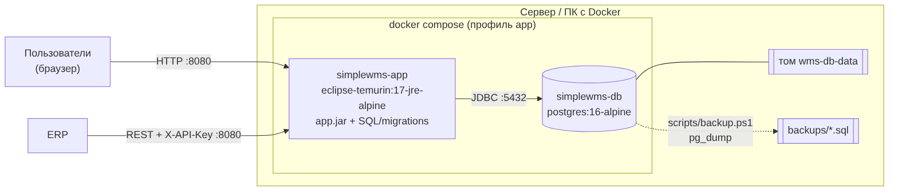

# Развёртывание SimpleWMS (Docker Compose)

Приложение и PostgreSQL работают в контейнерах Docker на одном компьютере или сервере.
Для разработки по-прежнему используется только контейнер базы и `gradlew bootRun`
(см. `Запуск_для_разработки.md`).

## Состав

| Контейнер | Образ | Назначение |
|---|---|---|
| `simplewms-db` | `postgres:16-alpine` | база данных; данные в томе Docker `wms-db-data` (сохраняются при пересоздании контейнера) |
| `simplewms-app` | `simplewms:latest` (собирается из `Dockerfile`) | приложение, порт 8080 |

Образ приложения собирается в два этапа: jar собирается в образе `gradle:8.12.1-jdk17`,
запускается в `eclipse-temurin:17-jre-alpine` от пользователя `wms` (не root).
В образ входят `app.jar` и `SQL/migrations` — скрипты начальных данных выполняются при каждом старте
и не меняют уже существующие записи.



Порядок запуска: база → проверка готовности (`pg_isready`) → приложение.
Состояние приложения проверяется запросом к странице входа (`docker ps`, колонка STATUS: `healthy`).

## Требования

- Docker Desktop (Windows, macOS) или Docker Engine с плагином Compose (Linux).
- Доступ в интернет при первой сборке (образы и библиотеки Maven Central).
- Свободные порты 8080 (приложение) и 5432 (база; можно изменить в `.env`).

## Первый запуск

1. Скопировать `.env.example` в `.env` и задать:
   - `WMS_API_KEY` — **свой** ключ для ERP (с пустым ключом приложение в профиле prod не запустится);
   - `DB_PASSWORD` — пароль базы (до первого запуска: при существующем томе пароль уже задан);
   - `APP_PROFILES` — `prod` (рабочий режим) или `prod,demo` (показ, см. ниже);
   - при необходимости `APP_PORT`, `WMS_COMPANY_NAME`, `JAVA_OPTS`.
2. Собрать и запустить:
   ```powershell
   docker compose --profile app up -d --build
   ```
   Первая сборка занимает несколько минут.
3. Дождаться состояния `healthy`:
   ```powershell
   docker ps
   ```
4. Открыть http://localhost:8080, войти `admin` / `admin`.
5. **Сразу сменить пароль администратора** (Администрирование → Пользователи), завести сотрудников и пользователей.

В профиле `prod` загружаются только справочные данные: роли, администратор, ABC-классы,
системные зоны и ячейки приёмки и отгрузки. Зоны, ячейки хранения, товары и контрагенты заводятся
в справочниках или загружаются из ERP (API).

## Демо-режим

`APP_PROFILES=prod,demo` дополнительно загружает демо-данные: товары, поставщика, клиентов,
зоны SC1/SC2 с 24 ячейками и пользователей `manager/manager`, `storekeeper/storekeeper`.
Удобно для показа: сразу можно пройти сценарий приёмка → размещение → заказ → сборка → отгрузка
(`Чек-лист_тестирования.md`). Демо-данные добавляются к существующим; для чистого показа — сброс базы (ниже).

## Обновление версии

```powershell
git pull
docker compose --profile app up -d --build
```

Пересобирается и перезапускается только приложение, данные базы сохраняются.
Схема базы обновляется автоматически (Hibernate `ddl-auto=update`); перед обновлением рекомендуется
сделать резервную копию.

## Резервное копирование

```powershell
scripts\backup.cmd
```

Создаёт `backups\wms_ГГГГММДД_ЧЧММ.sql` (полный SQL-дамп, `pg_dump --clean --if-exists`).
Папка `backups` не попадает в git. Копии лучше хранить и на другом диске.

Восстановление (текущие данные заменяются копией):

```powershell
scripts\restore.cmd backups\wms_20261010_1200.sql
```

`.cmd` — обёртки, запускающие `.ps1` в обход политики выполнения сценариев Windows
(«выполнение сценариев отключено в этой системе»); можно и напрямую:
`powershell -ExecutionPolicy Bypass -File scripts\restore.ps1 <файл>`.

Скрипт спрашивает подтверждение (`-Force` — без вопроса), на время восстановления останавливает
контейнер приложения и затем запускает его снова. Если приложение запущено через `gradlew bootRun`,
его нужно остановить вручную.

Без скриптов (Linux):

```bash
docker exec simplewms-db pg_dump -U admin -d wms --clean --if-exists --no-owner > wms.sql
docker exec -i simplewms-db psql -U admin -d wms -v ON_ERROR_STOP=1 < wms.sql
```

## Управление

| Действие | Команда |
|---|---|
| Состояние | `docker ps` |
| Журнал приложения | `docker logs -f simplewms-app` |
| Остановить всё | `docker compose --profile app stop` |
| Запустить снова | `docker compose --profile app start` |
| Удалить контейнеры (данные сохраняются) | `docker compose --profile app down` |
| Сброс базы (**все данные удаляются**) | `docker compose --profile app down -v` |
| Консоль базы | `docker exec -it simplewms-db psql -U admin -d wms` |

## Частые проблемы

| Симптом | Причина и решение |
|---|---|
| `simplewms-app` сразу останавливается, в журнале «не задан ключ REST API» | В `.env` пустой `WMS_API_KEY` — задать ключ |
| В журнале предупреждение «используется ключ API разработки» | В `.env` остался `dev-api-key` — заменить на свой |
| `port is already allocated` | Порт занят (например, запущен `bootRun` или другая база) — остановить или изменить `APP_PORT` / `DB_PORT` |
| `password authentication failed` после смены `DB_PASSWORD` | Пароль задаётся при создании тома; вернуть прежний или сбросить базу (`down -v`) |
| Сборка образа падает на загрузке зависимостей | Нет доступа к Maven Central — проверить интернет/прокси, повторить сборку |
| «выполнение сценариев отключено в этой системе» при запуске `.ps1` | Запускать через `scripts\backup.cmd` / `scripts\restore.cmd` или `powershell -ExecutionPolicy Bypass -File ...` |
| Состояние `unhealthy` дольше 2 минут | `docker logs simplewms-app` — ошибка подключения к базе или настроек |
