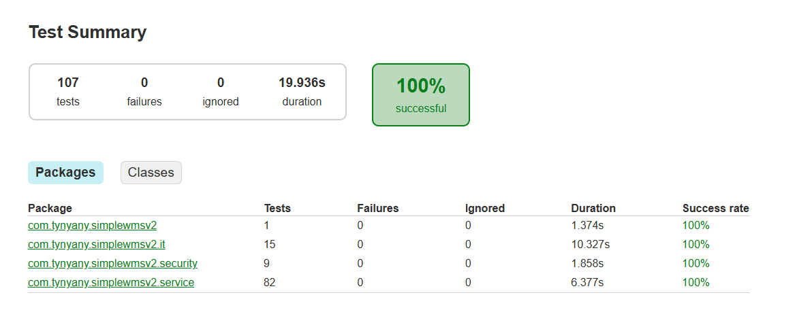

# Результаты тестирования

Дата: 10.10.2026. Версия: этап 11 плана доработки и позже.
Запуск автотестов — `.\gradlew.bat test` (раздел «Тесты» в `Запуск_для_разработки.md`).

## 1. Итоги

| Показатель | Значение |
|---|---|
| Автоматических тестов | 107 |
| Успешно | 107 (100 %) |
| Ошибок / пропущено | 0 / 0 (при запущенном Docker) |
| Время прогона | ≈ 20 с (из них интеграционные ≈ 10 с) |
| Покрытие кода (JaCoCo), инструкции | 45 % всего проекта, 62 % слоя сервисов, 92 % безопасности |

*Рисунок 36 — Отчёт о прогоне тестов (`build/reports/tests/test/index.html`)*

## 2. Состав автотестов

### 2.1. Модульные тесты (JUnit 5 + Mockito) — 91

Проверяют бизнес-правила сервисов без базы данных (репозитории заменены заглушками).

| Класс | Тестов | Что проверяется |
|---|---:|---|
| `DefaultReceivingProcessServiceTest` | 21 | загрузка накладной (дубль, неизвестный поставщик, пропуск неизвестных товаров), приёмка строки, срок годности, повторная приёмка, возврат строки, завершение, отмена с откатом остатка |
| `DefaultPickingServiceTest` | 10 | маршрут по резервам в порядке обхода, запрет для частично зарезервированного и уже переданного заказа, подтверждение до начала, недостача, отмена |
| `DefaultInventoryServiceTest` | 9 | поступление и сложение с остатком, перемещение, списание, нехватка остатка, нулевое количество, перемещение в ту же ячейку, запись в журнал движений |
| `DefaultOrderServiceTest` | 7 | резерв FEFO, частичный резерв и дорезервирование, дубль номера, ручной заказ, отмена со снятием резерва |
| `DefaultPlacementServiceTest` | 7 | формирование маршрутов по зонам, ячейка из приёмки, подтверждение в другую ячейку, запрет системных ячеек, отмена |
| `PlacementCellPickerTest` | 7 | подбор ячейки: ячейка с тем же товаром, ближайшая свободная в зоне ABC-класса, учёт объёма следующих строк, переход в другую зону, нет места, работа без настроек ABC |
| `DefaultShippingServiceTest` | 7 | отгрузка по собранным строкам, номер ОТГ-N, повторная отгрузка, несобранный заказ, выгрузка в ERP, подтверждение |
| `DefaultTransferServiceTest` | 6 | перемещение с типом «Перемещение», резерв не перемещается, системные/удалённые/та же ячейка, превышение вместимости — предупреждение |
| `DefaultErpServiceTest` | 5 | создание и обновление товаров, неизвестный поставщик, повтор кодов в запросе, отмена заказа по номеру |
| `DefaultReportServiceTest` | 3 | состояние срока годности, свод по товарам, экранирование шаблона поиска |
| `DbUserDetailsServiceTest`, `ApiKeyAuthenticationFilterTest`, `PasswordMigrationTest` | 9 | роль сотрудника → права, удалённый пользователь или сотрудник, неизвестный логин, ключ API (верный, неверный, не настроен), распознавание BCrypt |

### 2.2. Интеграционные тесты (Spring Boot + PostgreSQL 16 в Testcontainers) — 16

Запускают полное приложение на временной базе (схема и начальные данные создаются заново).

| Класс | Тестов | Что проверяется |
|---|---:|---|
| `WarehouseFlowIT` | 1 | сквозной сценарий: справочники и накладная через API → приёмка с недостачей → размещение по ABC-зонам → заказ (полный резерв), второй заказ с частичным резервом и отменой через API → сборка с недостачей → отгрузка → выгрузка и подтверждение в ERP; на каждом шаге — остатки по зонам, резервы, статусы, журнал движений, отчёты; итоговый баланс «принято = на складе + отгружено» |
| `RepositoryQueriesIT` | 6 | SQL-запросы на реальной базе: FEFO (просроченные не резервируются, системные ячейки исключены), состояние склада (сроки, поиск по штрихкоду, фильтр ячейки, зона отгрузки), загрузка ячеек, сводка, журнал движений |
| `ApiAndSecurityIT` | 8 | вход через форму, права ролей на страницах и API, ключ API, CSRF для браузерной сессии, ошибки 400 (по полям, на русском) / 404 / 409 |
| `SimpleWmsv2ApplicationTests` | 1 | запуск приложения и загрузка начальных данных |

## 3. Покрытие кода

Отчёт JaCoCo: `build/reports/jacoco/test/html/index.html` (формируется после каждого прогона тестов).

| Пакет | Инструкции | Ветвления | Комментарий |
|---|---:|---:|---|
| `security` | 92 % | 67 % | |
| `domain` (статусы) | 88 % | 69 % | |
| `dto.erp` (формат API) | 92 % | 75 % | |
| `service` | 62 % | 59 % | новые сервисы процессов покрыты почти полностью; ниже — CRUD-сервисы справочников |
| `exception` | 49 % | 44 % | |
| `controller` | 10 % | 4 % | контроллеры страниц проверяются интеграционными и ручными тестами |
| **Всего** | **45 %** | **44 %** | |

## 4. Ручное тестирование

Каждый этап доработки (приёмка, размещение, перемещение, заказы, комплектация, отгрузка, отчёты, API, развёртывание)
проверялся в интерфейсе после реализации; полный сценарий — `Чек-лист_тестирования.md` (9 разделов, все роли).

## 5. Производительность

Сервер разработки, демо-данные, время ответа (`curl`, повторный запрос):

| Страница / метод | Время |
|---|---|
| Сводка по складу | 10–25 мс |
| Приход товара, состояние склада, журнал движений | 15–60 мс |
| Заказы, комплектация, отчёт по отгрузкам | 20–50 мс |
| `GET /api/v1/shipments` | ≈ 50 мс |

## 6. Ошибки, найденные при тестировании и исправленные

| № | Ошибка | Как найдена | Исправление |
|---|---|---|---|
| 1 | Резерв FEFO брал первыми партии с истёкшим сроком (у них самый ранний срок) | интеграционный тест `RepositoryQueriesIT` | просроченные партии исключены из резерва |
| 2 | Сообщения приёмки показывали внутренний id строки («строка 14» при 5 строках) | ручная проверка | номер по порядку и наименование товара |
| 3 | После входа могла открыться страница CSS-файла: скрипт темы обращался к несуществующему адресу | проверка в браузере (Playwright) | исправлен путь в `style-picker.js` |
| 4 | Кириллица в журнале контейнера выводилась как «???» | проверка запуска в профиле prod | `LANG=C.UTF-8`, `-Dfile.encoding=UTF-8` в образе |
| 5 | Приложение в контейнере не запускалось со старым `.env` без ключа API | проверка развёртывания | проверка `ProdSettingsCheck` с понятным сообщением, раздел «Частые проблемы» |
| 6 | В карточке накладной вес и объём выводились с погрешностью (2.3999999), даты — с микросекундами | подготовка руководства пользователя | округление до 0,01 и формат даты |
| 7 | Подсветка сроков в состоянии склада нечитаема в тёмной теме | подготовка руководства пользователя | тёмный текст на подсвеченных строках |
| 8 | Печать листа размещения падала из-за пустой строки в шаблоне | ручная проверка | исправлен шаблон |
| 9 | Изменения через GET-запросы в старом API (`/api/add_zones` и др.) | анализ кода | старый API удалён, `/api/v1` с POST/PUT |
