# Руководство пользователя

Руководство описывает работу в SimpleWMS по ролям. Снимки экрана сделаны на демо-данных
(профиль `demo`, см. `Развёртывание.md`). Порядок проверки всего цикла — `Чек-лист_тестирования.md`.

## 1. Общие сведения

### 1.1. Вход в систему

Откройте адрес системы (по умолчанию http://localhost:8080) и введите логин и пароль, выданные администратором.

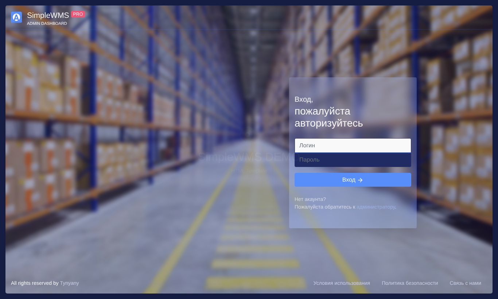

*Рисунок 12 — Страница входа*

Меню слева показывает только разделы, доступные вашей роли. При попытке открыть недоступный раздел
появляется сообщение «Недостаточно прав». Имя и роль пользователя — в правом верхнем углу, там же «Выход».

Результат каждого действия (принято, отменено, ошибка) показывается во всплывающем сообщении.

### 1.2. Сводка по складу

Главная страница показывает, что требует действий: приходы к приёмке, товар без маршрута размещения,
заказы к резервированию, сборке и отгрузке, маршруты сборки в работе, партии с истекающим сроком.
Каждая карточка открывает соответствующий раздел.

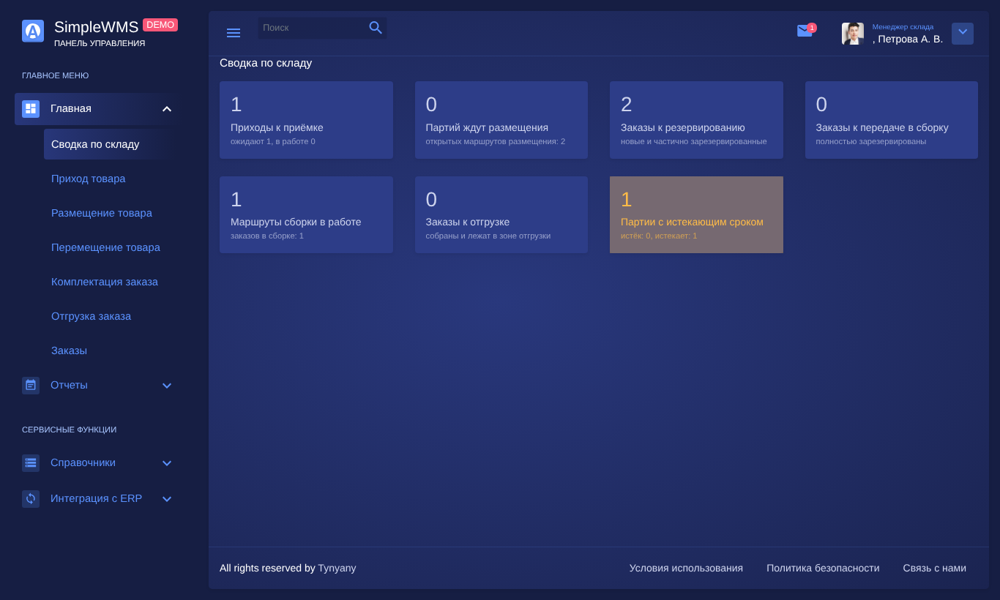

*Рисунок 13 — Сводка по складу (менеджер)*

## 2. Кладовщик

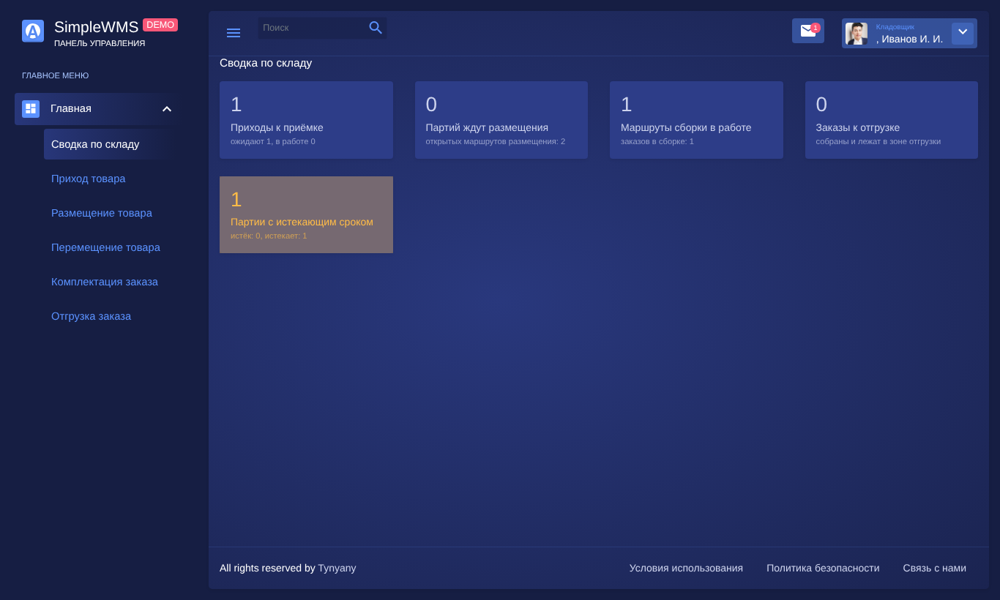

*Рисунок 14 — Меню и сводка кладовщика*

### 2.1. Приёмка товара

1. «Главная → Приход товара» — список накладных, загруженных из ERP. Статус «В ожидании» — приёмка не начата.

   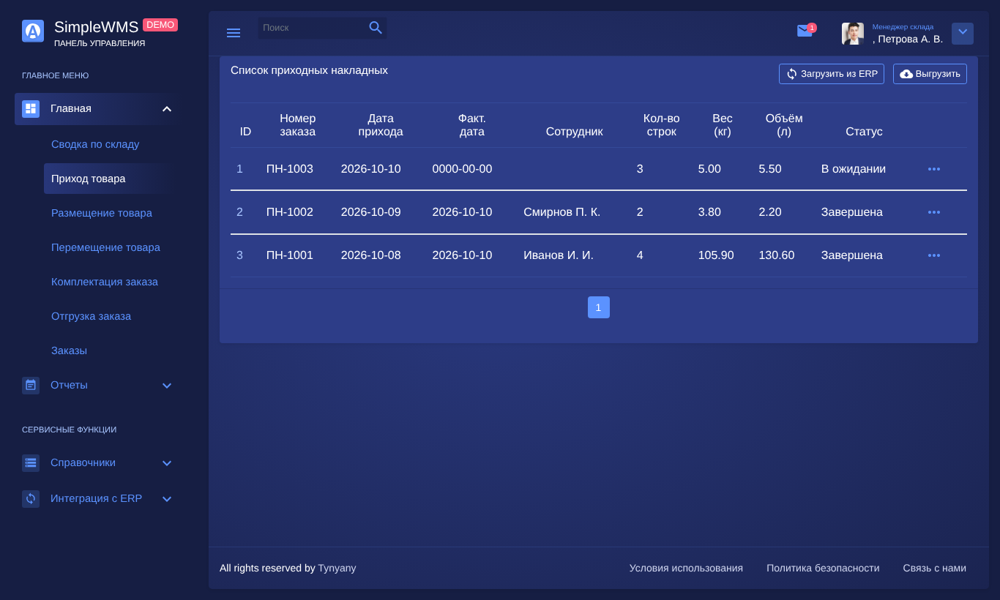

   *Рисунок 15 — Приход товара*

2. Откройте накладную и нажмите «Начать приёмку» (выберите кладовщика и дату).
3. По каждой строке: «Принять строку» → фактическое количество, срок годности (обязателен для товаров
   с учётом срока, например клея), при необходимости — место хранения (список фильтруется по зоне) и примечание.
   Количество меньше документа выделяется красным.
4. Ошибочно принятую строку можно исправить: «Отменить приёмку строки» — остаток списывается, строку можно принять снова.
5. Когда обработаны все строки — «Завершить приёмку».
6. «Документы → Товарная накладная (ТОРГ-12)» — печатная форма по фактически принятому.

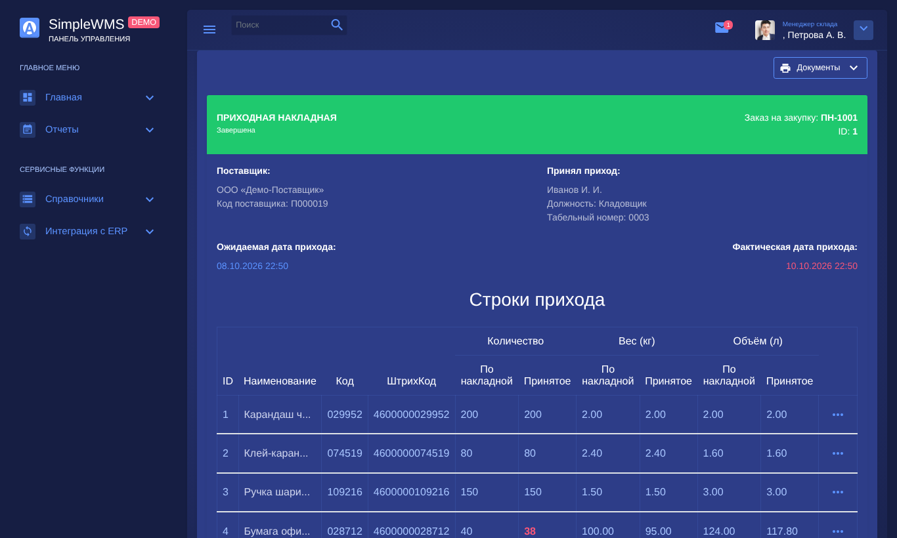

*Рисунок 16 — Приёмка по накладной*

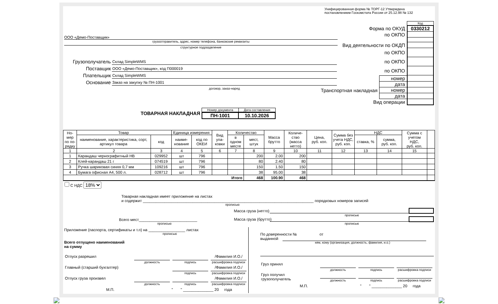

*Рисунок 17 — ТОРГ-12 по приёмке*

### 2.2. Размещение

1. «Размещение товара» → «Сформировать маршруты». Система подберёт ячейки и создаст маршрут на каждую зону хранения.
2. «Лист размещения» — печать для работы на складе.
3. «Взять в работу», затем по каждой строке разместите товар и нажмите «Подтвердить». Если товар положен
   в другую ячейку — выберите её в строке.
4. После последней строки маршрут становится «Завершён». Маршрут без подтверждённых строк можно отменить —
   товар снова попадёт в следующий маршрут.

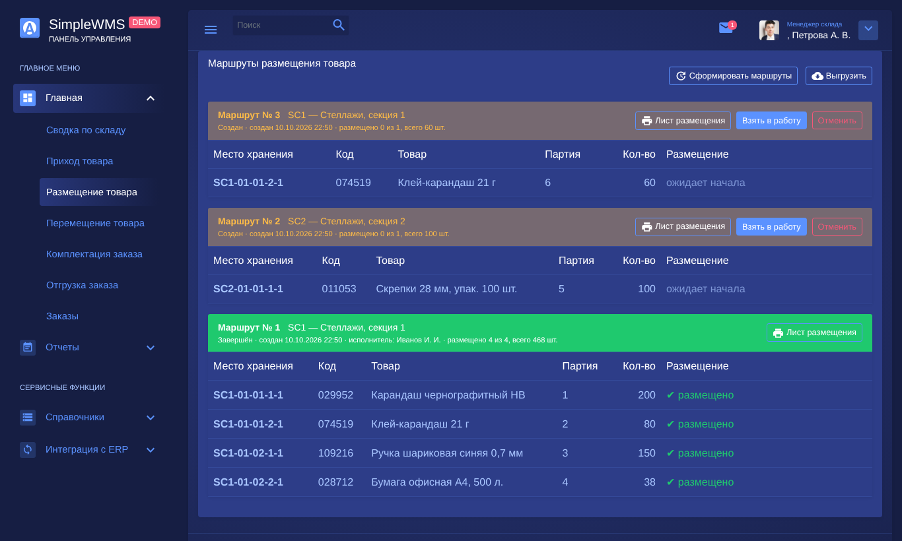

*Рисунок 18 — Маршруты размещения*

### 2.3. Перемещение

«Перемещение товара»:
- «Содержимое ячейки» — выберите ячейку, увидите партии, сроки, количество и резерв;
- «Где лежит товар» — поиск по коду, части наименования или штрихкоду;
- в строке укажите количество и ячейку назначения → «Переместить». Перемещать можно только свободное
  (не зарезервированное) количество;
- «Последние перемещения» — журнал.

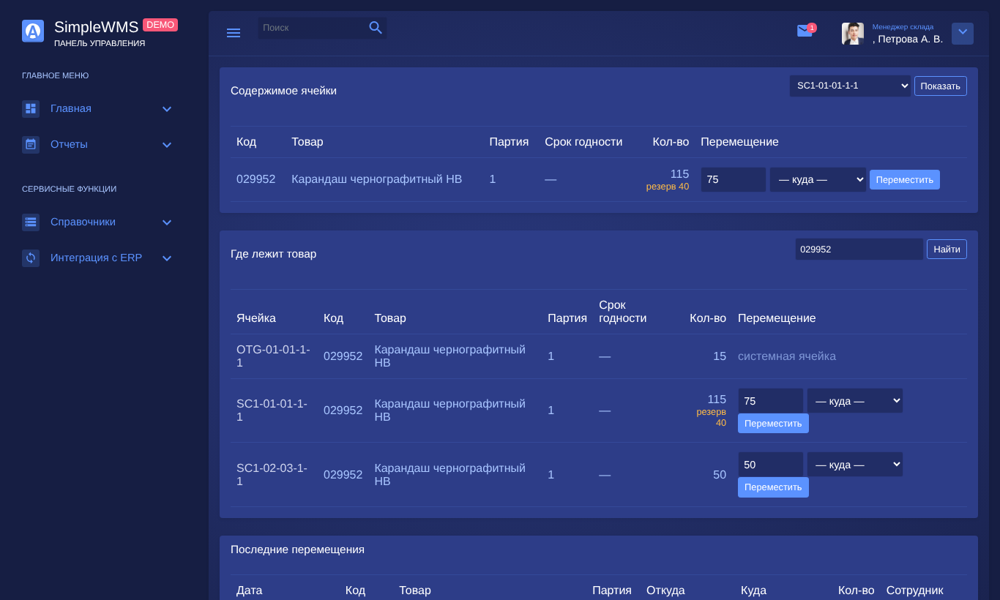

*Рисунок 19 — Перемещение товара*

### 2.4. Комплектация заказа

1. «Комплектация заказа» — маршруты сборки, переданные менеджером.
2. «Сборочный лист» — печать: заказ, клиент, адрес, ячейки в порядке обхода, сроки годности, вес и объём.
3. «Взять в работу». По каждой строке введите собранное количество и нажмите «Собрано». Если товара в ячейке
   меньше — введите фактическое количество, недостача будет отмечена.
4. Когда собраны все строки, заказ получает статус «Собран», товар — в зоне отгрузки.

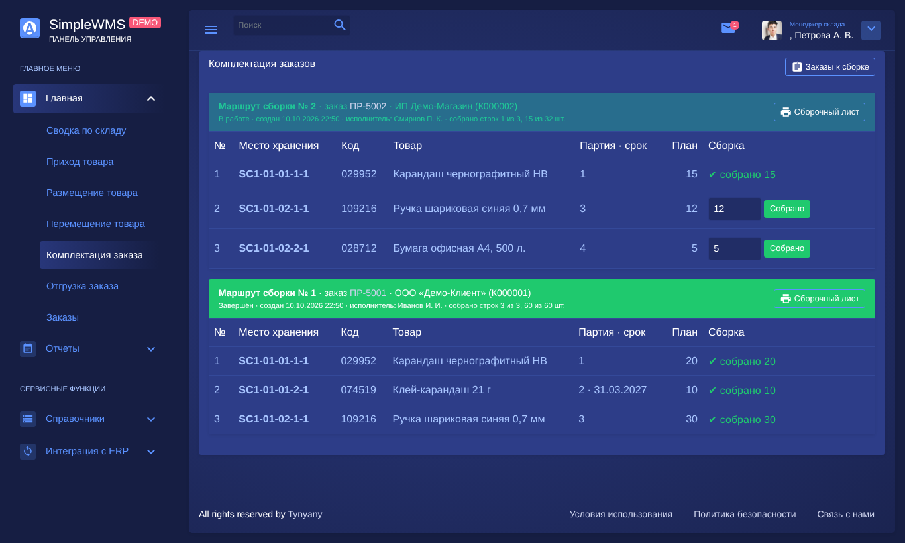

*Рисунок 20 — Комплектация заказов*

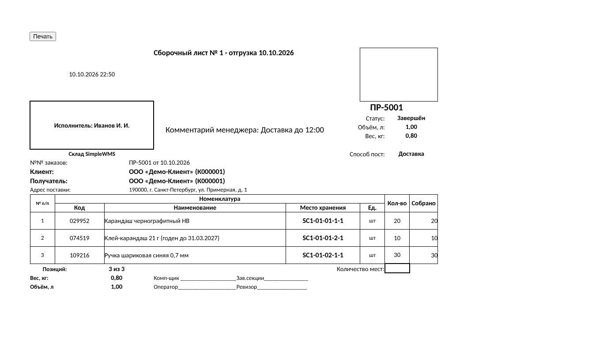

*Рисунок 21 — Сборочный лист*

### 2.5. Отгрузка

1. «Отгрузка заказа» — вверху собранные заказы (если собрано меньше заказанного — количество выделено).
2. «Отгрузить» → подтвердите. Создаётся документ ОТГ-N, товар списывается, заказ «Отгружен».
3. В журнале отгрузок — «ТОРГ-12» для печати и отметка о передаче в ERP.

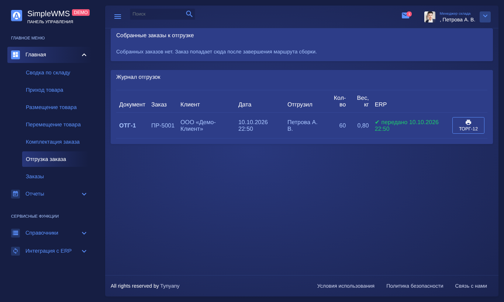

*Рисунок 22 — Отгрузка заказов*

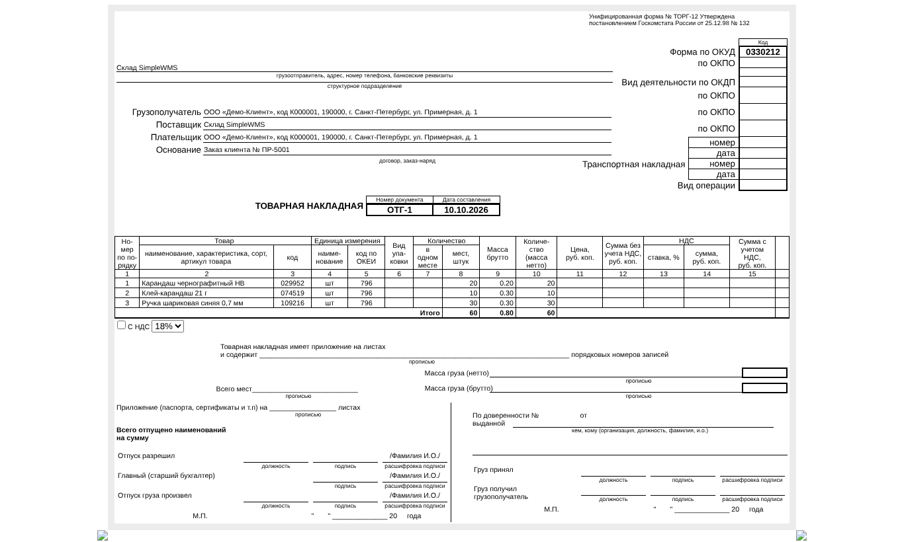

*Рисунок 23 — ТОРГ-12 на отгрузку*

## 3. Менеджер склада

Менеджеру доступны все операции кладовщика и разделы ниже.

### 3.1. Заказы клиентов

«Главная → Заказы»: список с фильтром по статусу и создание заказа вручную (клиент, номер — пусто для
автоматического, дата отгрузки, примечание).

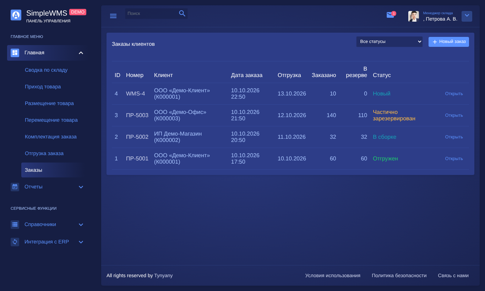

*Рисунок 24 — Заказы клиентов*

Карточка заказа:
- «Новый» заказ — добавление и удаление строк, «Зарезервировать»;
- «Частично зарезервирован» — колонка «Не хватает», «Дорезервировать» после поступления товара;
- «Зарезервирован» — «Передать в сборку» (создаётся маршрут для кладовщика);
- «Отменить заказ» — до передачи в сборку, резерв снимается;
- после сборки и отгрузки — колонки «Собрано», «Отгружено», ссылки на сборочный лист и ТОРГ-12.

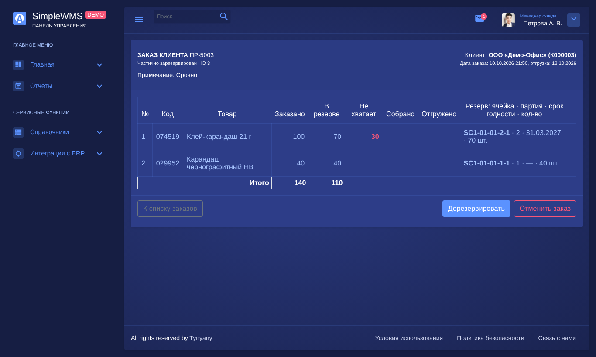

*Рисунок 25 — Карточка заказа: частичный резерв по FEFO*

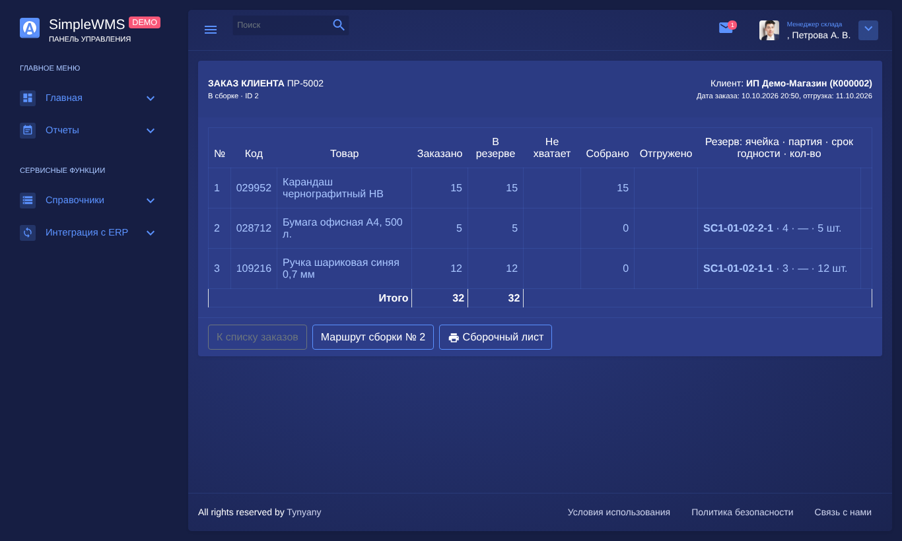

*Рисунок 26 — Карточка заказа в сборке*

### 3.2. Справочники

«Сервисные функции → Справочники»: товары, поставщики, клиенты, места хранения, зоны хранения.
Товары, поставщиков и клиентов обычно загружает ERP; кнопка «Загрузить из ERP» открывает имитацию обмена.

### 3.3. Отчёты

«Отчёты → Состояние склада» — три вида:
- по товарам: всего, в хранении, в резерве, свободно, в приёмке, в зоне отгрузки;
- по партиям и ячейкам: срок годности, резерв, свободно; красным — истёкшие, жёлтым — истекают в ближайшие 30 дней;
- загрузка ячеек: занятый объём, вместимость, процент заполнения.

Фильтры: товар (код, название, штрихкод), зона, ячейка, «только с истекающим сроком».

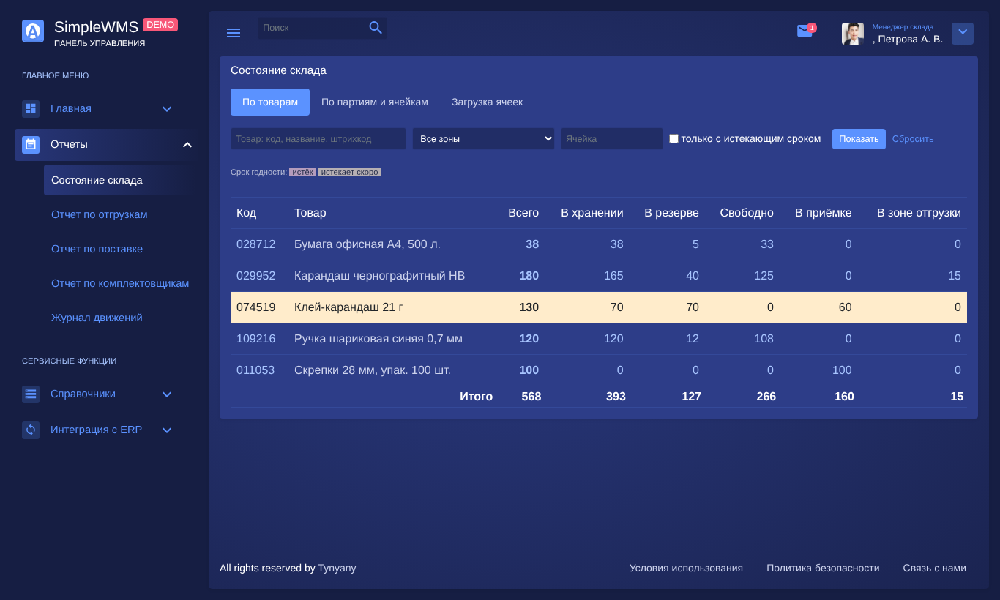

*Рисунок 27 — Состояние склада по товарам*

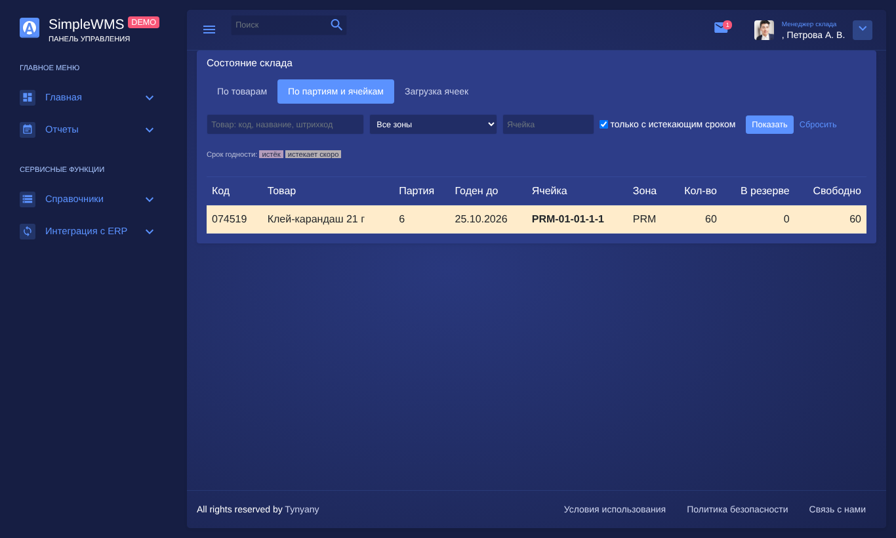

*Рисунок 28 — Партии с истекающим сроком годности*

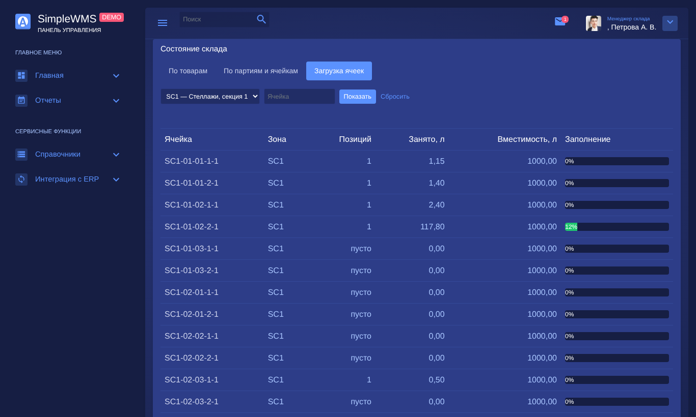

*Рисунок 29 — Загрузка ячеек*

«Журнал движений» — все движения товара с фильтрами по периоду, типу, товару и партии.

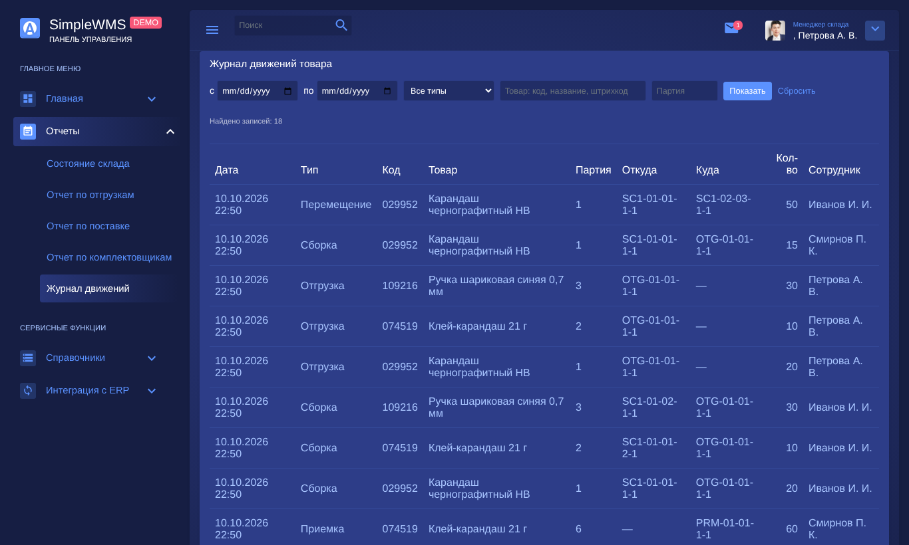

*Рисунок 30 — Журнал движений*

Отчёты за период (по умолчанию — с начала месяца): по отгрузкам (клиенты, товары, недогруз),
по поставкам (поставщики, товары, расхождения), по комплектовщикам (сборка и размещение по сотрудникам).

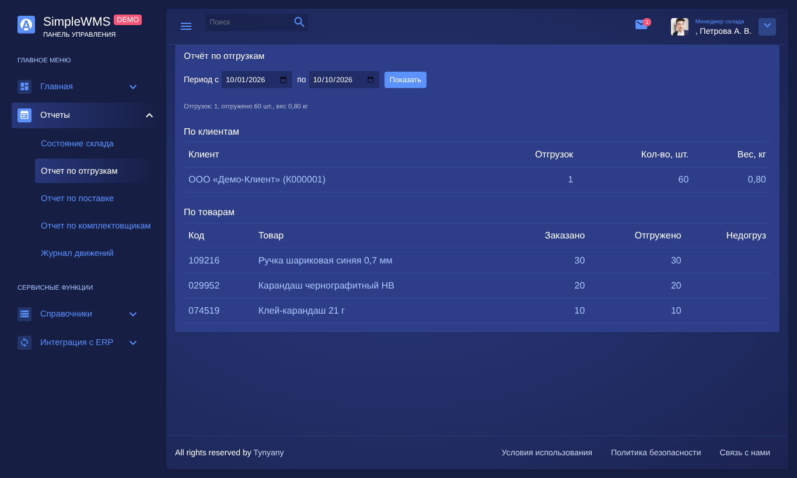

*Рисунок 31 — Отчёт по отгрузкам*

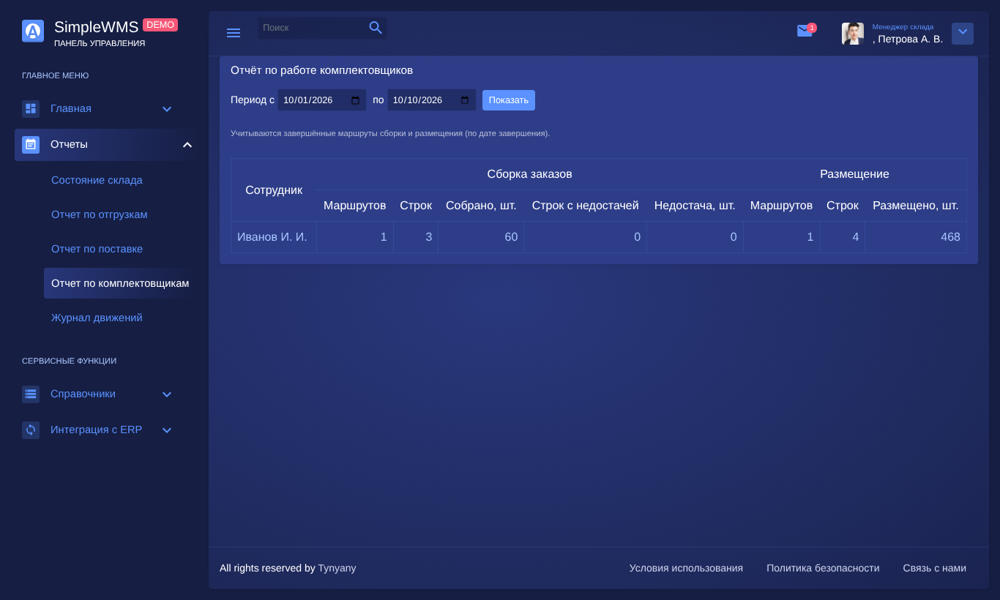

*Рисунок 32 — Отчёт по работе комплектовщиков*

### 3.4. Интеграция с ERP

«Интеграция с ERP → Имитация ERP»: готовые запросы (справочники, накладная, заказ, статусы, выгрузка отгрузок).
Пример можно изменить и отправить — ответ API показывается на странице.
«Описание API» — Swagger UI (подробно — `API.md`).

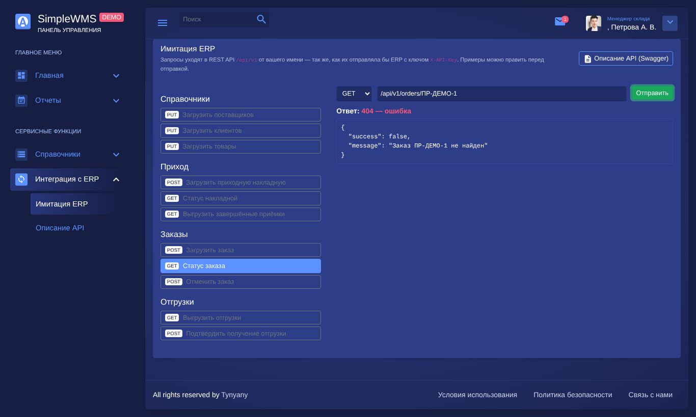

*Рисунок 33 — Имитация ERP*

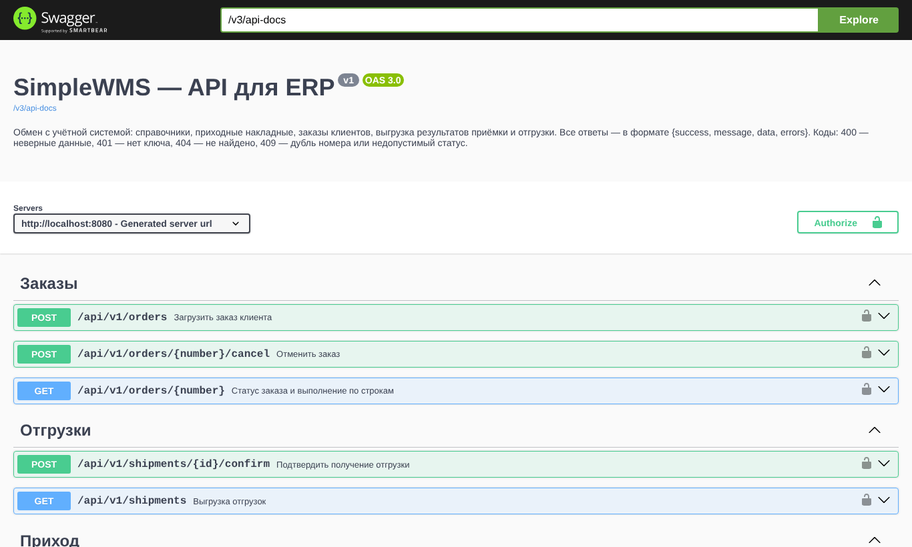

*Рисунок 34 — Описание API (Swagger UI)*

## 4. Администратор

Администратору доступны все разделы, а также «Администрирование»:
- «Сотрудники» — ФИО, табельный номер, роль (Администратор, Менеджер склада, Кладовщик);
- «Пользователи» — учётная запись для сотрудника (логин, пароль), сброс пароля, удаление.

Права пользователя определяются ролью его сотрудника. После первого запуска в рабочем режиме смените пароль
учётной записи `admin`.

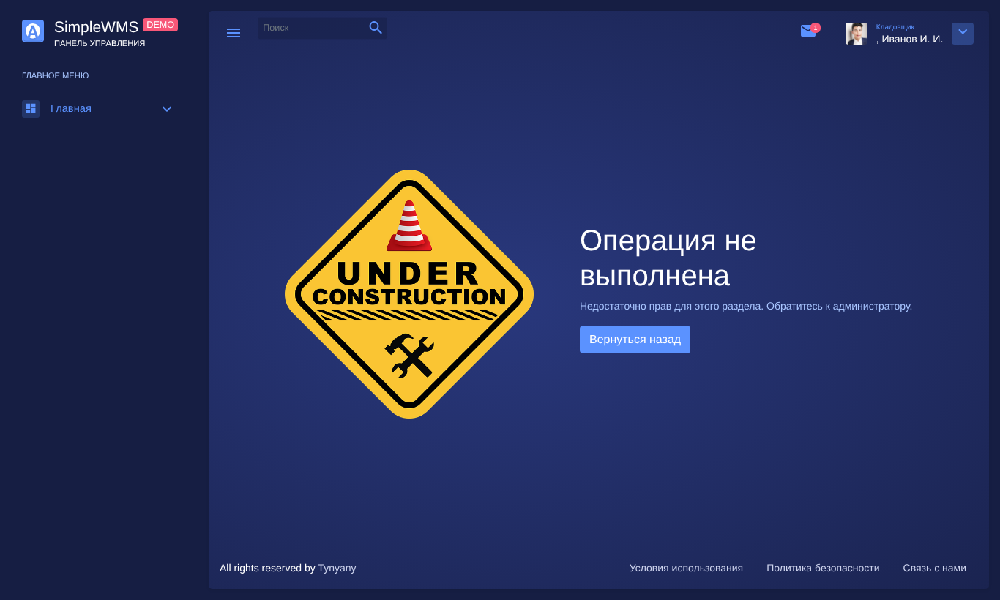

*Рисунок 35 — Попытка открыть раздел без прав*
